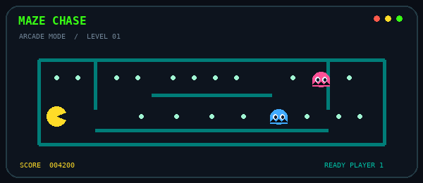
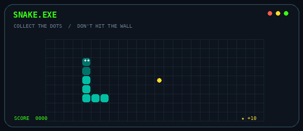
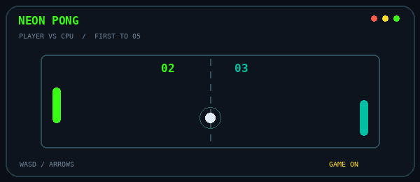
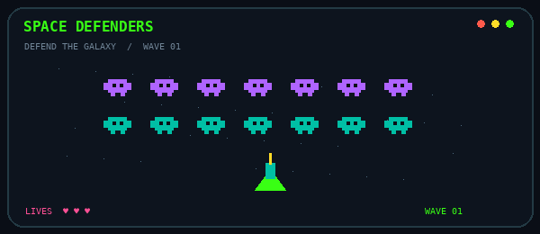

<!--
  VES//LAB — Veselin Stoyanov's GitHub profile.
  One README. No new assets. No invented projects.
  The arcade GIFs live in this repository's root.
  The contribution snake is generated by the existing GitHub Action.
-->

<div align="center">

<sub>✦ &nbsp; PERSONAL WORKSPACE / EST. ONE EXPERIMENT AT A TIME &nbsp; ✦</sub>

# V E S E L I N <code>_</code>

**Veselin Stoyanov** &nbsp; · &nbsp; `@VeselinSv`

**Code things. Break things. Understand things. Build again.**

<sup>💻 SOFTWARE &nbsp; / &nbsp; 🌐 WEB &nbsp; / &nbsp; 🎮 UNITY &nbsp; / &nbsp; 🔌 ARDUINO</sup>

<br>

<a href="https://github.com/VeselinSv?tab=repositories"><kbd>↗ EXPLORE MY REPOS</kbd></a>
&nbsp;
<a href="https://x.com/VeselinStoqnov6"><kbd>↗ FIND ME ON X</kbd></a>

<br><br>

<sub><a href="#about">ABOUT</a> &nbsp;·&nbsp; <a href="#workbench">WORKBENCH</a> &nbsp;·&nbsp; <a href="#quest">QUEST</a> &nbsp;·&nbsp; <a href="#arcade">ARCADE</a> &nbsp;·&nbsp; <a href="#contributions">SNAKE</a></sub>

</div>

---

### `> boot veselin.dev`

```text
┌─ VS / PERSONAL LAB ─────────────────────────┐
│                                             │
│  NAME       Veselin Stoyanov                │
│  MODE       curiosity-driven development   │
│  INTERESTS  code · games · electronics     │
│  STRATEGY   experiment → debug → improve   │
│                                             │
│  [✓] ready to build something              │
└─────────────────────────────────────────────┘
```

<a id="about"></a>

## `01 /` The person behind the code

I'm **Veselin**, and I like learning how things work by actually making them.

Sometimes that's building a webpage. Sometimes it's trying a new mechanic in **Unity**. Sometimes it's connecting code to the physical world with **Arduino**. I don't want to stick to one corner of technology when there's so much to explore.

My favorite part? That moment when a bug finally makes sense and the thing I was building *actually works*.

> **No fake “10x developer” energy here.** Just curiosity, small experiments, a lot of debugging, and progress one project at a time.

<a id="workbench"></a>

## `02 /` My workbench

<table>
<tr>
<td width="50%" valign="top">
<strong><code>01</code> 💻 CODE / LOGIC</strong>
<br><br>
<code>C#</code> · <code>JavaScript</code>
<br><br>
Programming fundamentals, application logic, problem-solving and debugging.
</td>
<td width="50%" valign="top">
<strong><code>02</code> 🌐 WEB / PIXELS</strong>
<br><br>
<code>HTML</code> · <code>CSS</code> · <code>JavaScript</code>
<br><br>
Pages, layouts, interactions and things that run in a browser.
</td>
</tr>
<tr>
<td valign="top">
<strong><code>03</code> 🎮 GAMES / SYSTEMS</strong>
<br><br>
<code>Unity</code> · <code>C#</code>
<br><br>
Gameplay experiments, scripts, movement and game mechanics.
</td>
<td valign="top">
<strong><code>04</code> 🔌 HARDWARE / SIGNALS</strong>
<br><br>
<code>Arduino</code> · <code>Electronics</code>
<br><br>
Microcontrollers and the connection between software and real hardware.
</td>
</tr>
</table>

<details>
<summary><b>＋ Open the toolbox</b></summary>

<br>

`Git` · `GitHub` · `VS Code` · `Visual Studio` · `Debugging` · `Version Control`

<sub>These are tools and technologies I'm learning or working with, not a list of things I've mastered.</sub>

</details>

<a id="quest"></a>

## `03 /` Current quest

**🎮 PROJECT: MY FIRST UNITY GAME** &nbsp; `IN PROGRESS`

I'm learning Unity and C# by experimenting with game logic and gameplay mechanics. The goal isn't to make the world's biggest game — it's to finish something **playable** and understand how I built it.

| Quest log | Progress |
| :--- | :--- |
| Explore Unity and C# | `✓ started` |
| Experiment with scripts and game logic | `↻ practicing` |
| Build and refine gameplay mechanics | `↻ experimenting` |
| Finish the first playable game | `○ goal` |

**Side quests:** web development, small software experiments, and Arduino ideas.

[**→ Browse what I've actually built**](https://github.com/VeselinSv?tab=repositories)

<a id="arcade"></a>

## `04 /` Arcade room

<div align="center">

*Four little retro animations. Because not every pixel needs to be productive.*

<table>
<tr>
<td width="50%" align="center"><b>01 // PAC-MAN</b><br><br></td>
<td width="50%" align="center"><b>02 // SNAKE</b><br><br></td>
</tr>
<tr>
<td align="center"><b>03 // NEON PONG</b><br><br></td>
<td align="center"><b>04 // SPACE INVADERS</b><br><br></td>
</tr>
</table>

<sub>These are looping GIF animations, not playable games. They already exist in this repository.</sub>

</div>

<a id="contributions"></a>

## `05 /` Contribution snake

<div align="center">

**THE ONLY SNAKE THAT EATS MY GITHUB CONTRIBUTIONS** 🐍

<sub>Generated automatically with my existing <a href="https://github.com/VeselinSv/VeselinSv/actions/workflows/snake.yml">GitHub Actions workflow</a>.</sub>

<br><br>

<picture>
  <source media="(prefers-color-scheme: dark)" srcset="https://raw.githubusercontent.com/VeselinSv/VeselinSv/output/github-snake-dark.svg">
  <source media="(prefers-color-scheme: light)" srcset="https://raw.githubusercontent.com/VeselinSv/VeselinSv/output/github-snake.svg">
  
</picture>

</div>

---

<details>
<summary><b>⚽ OFFLINE MODE // the human stuff</b></summary>

<br>

Outside the editor, I'm into **football, video games, computers**, and the kind of creative challenges that make you think *"I wonder if I could build that…"*

</details>

<div align="center">

### `> end_of_file`

**Still learning. Still building. Still curious.**

<a href="https://github.com/VeselinSv">GitHub</a> &nbsp;·&nbsp; <a href="https://github.com/VeselinSv?tab=repositories">Projects</a> &nbsp;·&nbsp; <a href="https://x.com/VeselinStoqnov6">X</a>

<sub>Made with curiosity, code & an unreasonable number of debugging attempts. — Veselin</sub>

</div>
